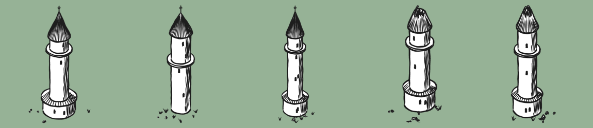
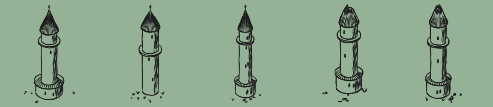

# Wonderdraft Assets

A procedural generator for hand-inked fantasy map symbols: ruins, beast lairs, divine sites and
land features. Each run draws as many variants as you ask for. Every symbol is built from random
parts, so no two come out the same, and the stroke weight and shading stay the same across the
whole set. Output is transparent PNGs laid out the way Wonderdraft expects custom symbols.

## Examples

**Ruined cottages**: walls collapse differently each time. Some keep part of their roof, some
only the bare rafters or a standing chimney.


**Round spires**: intact, caved-in or snapped roofs, with an optional lower drum and balcony.




## Quick start

```bash
python3 -m venv .venv
.venv/bin/pip install -r requirements.txt

.venv/bin/python generate.py                 # every type, 12 variants each
.venv/bin/python generate.py --style line    # the same, as pure line art
```

Then copy the pack folder from `out/` (for example `out/RuinsAndLairs/`) into Wonderdraft's
`assets` folder and restart Wonderdraft.

## Options

| Option | Default | Meaning |
|---|---|---|
| `-t`, `--types` | all | Comma list of type names (`cottage,round_spire`) or category words (`land`, `cave`, `divine`) |
| `-n`, `--count` | 12 | Variants per type |
| `--seed` | 1 | Change it for a fresh batch. The same seed always redraws the same symbols |
| `--style` | `filled` | `filled`: ink with white paper inside shapes. `line`: ink only, so the map colour shows through |
| `--res` | 3 | Output pixels per drawing unit (higher = bigger, crisper PNGs) |
| `--ink` | `1e1e1e` | Ink colour (hex) |
| `--wash` | `96623e` | Colour of the cliff/canyon shading (hex), or `none` for ink only |
| `--pack` | `RuinsAndLairs` | Pack folder name (the line style gets a `Line` suffix) |

File names include the type, seed and index (`cottage_1_007.png`), so you can always regenerate a
symbol you like.

## Output

```
out/RuinsAndLairs/sprites/symbols/<Category>/<type>_<seed>_<n>.png
preview/<Group>/<Category>_<style>.png      contact sheet per category
```

The contact sheets are for choosing what to keep. Categories made of several piece types (like the
cliff curves) get one labelled row per type.

## Categories

| Group | Categories |
|---|---|
| Ruins | Cottages, Villages, Round Towers, Keeps, Castles, Round Spires, Gothic Spires |
| Lairs | Hill Caves, Cliff Caves, Boulder Caves, Sunken Entrances, Burrows, Warrens, Crag Nests, Ground Nests |
| Divine | Temples, Stone Circles, Colossi, Robed Statues, Swords, Obelisks |
| Land | Fields, Cliffs, Steep Cliffs, Cliff Curves, Cliff Bays, Mesas, Terraced Hills, Canyons, Canyon Bends |

Buildings, lairs and monuments are drawn in the same 3/4 top-down view as Wonderdraft's default
houses.

## Cliffs, canyons and mountains

Land edges are open lines: an ink edge, short strokes hanging below it where the cliff face is
visible, and a fading wash. All pieces share one face-height range and have tapered, open ends,
so you build longer edges by overlapping pieces. You never need to rotate a piece.

Every edge knows which side is the low ground. The face only appears where the drop faces the
viewer, and it fades out as the edge turns sideways. So:

- **Cliff Curves** has one piece for each part of a plateau outline: `curve_front`,
  `curve_back`, `curve_left_end`, `curve_right_end` and the four corners. A front piece, two ends
  and a back piece make a closed ring.
- **Cliff Bays** are the inner (concave) versions, for notches in an outline.
- **Mesas** are a complete plateau in one symbol. **Terraced Hills** stack 2–4 of them into a
  whole hill or mountain.
- **Canyons** and **Canyon Bends** follow the same rules, so bends join straight runs.

The wash is a second colour. These symbols won't tint as one colour unless you use `--wash none`.

## Project layout

| File | Contents |
|---|---|
| `generate.py` | CLI and the list of types (`TYPES`: category, draw function, canvas size) |
| `wdgen/ink.py` | Canvas (ink, paper and wash layers) and the brush: tapered strokes, hatching, tufts, bushes, stones |
| `wdgen/proj.py` | The 3/4 orthographic projection shared by every 3D symbol |
| `wdgen/solids.py` | Boxes, cylinders, cones, pyramids, broken columns, earth mounds |
| `wdgen/ruins.py` | Damaged walls, roofs, cottages, towers, keeps, villages |
| `wdgen/castles.py` | Crenellated curtain walls, castles, spires |
| `wdgen/lairs.py` | Caves, burrows, nests, bones and other remains |
| `wdgen/divine.py` | Temples, stone circles, statues, swords, obelisks |
| `wdgen/terrain.py` | Fields, cliff edges, curves, mesas, terraced hills, canyons |

To add a symbol type, write a `draw(pen, P, rng)` function (`P` projects world `(x, y, height)` to
the canvas, and `pen` draws strokes) and add it to `TYPES` in `generate.py`.
