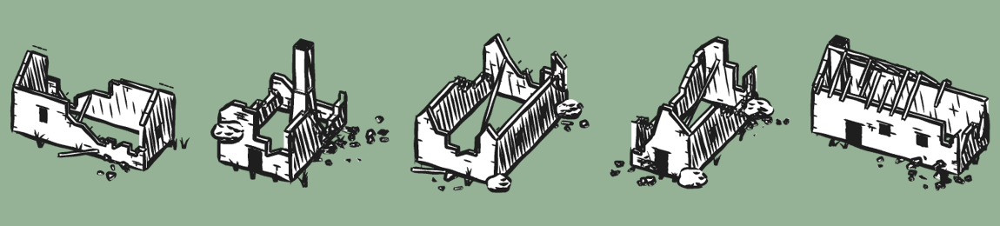
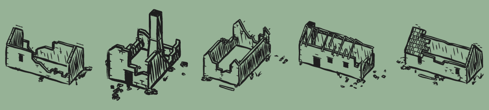
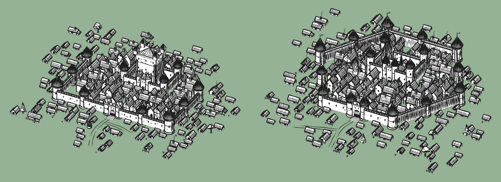
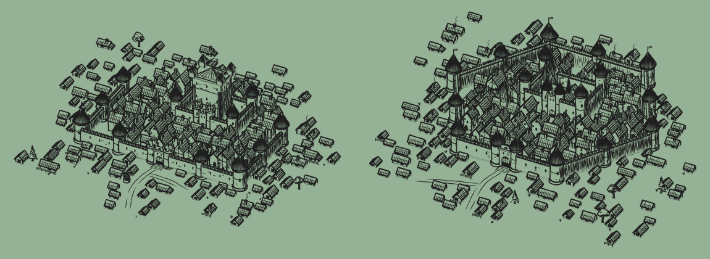
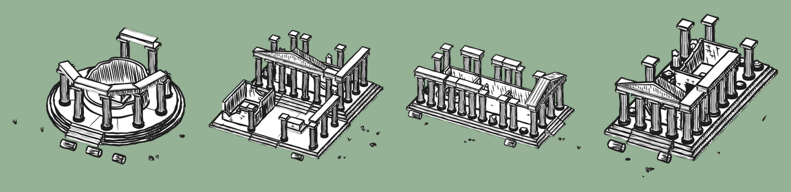
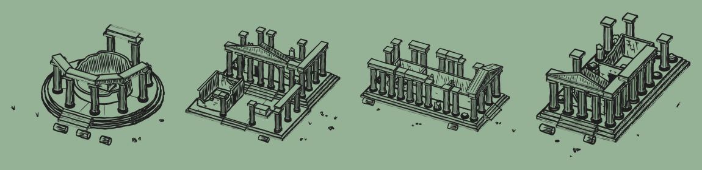

# Inkwright

A Wonderdraft asset generator.


A procedural generator for hand-inked fantasy map assets: tree and mountain brush pools,
settlements, ruins, beast lairs, divine sites and land features. Each run draws as many variants
as you ask for. Every sprite is built from random parts, so no two come out the same, and the
stroke weight and shading stay the same across the whole set. Output is transparent PNGs laid out
the way Wonderdraft expects custom symbols, trees and mountains.

## Examples

**Ruined cottages**: walls collapse differently each time. Some keep part of their roof, some
only the bare rafters or a standing chimney.




**Cities**: three-tier fortified metropolises combining an inner walled citadel (royal keep or
cathedral), a dense middle ring of tiled townhouses inside multi-tower ramparts, and sprawling
outer suburbs of thatched cottages along approach roads.




**Divine temples**: classical Greek-style ruins in circular tholos, terraced forecourt, wide
east–west and deep north–south layouts, with fluted columns, pediments, inner chambers and
fallen column drums.




## Quick start

```bash
python3 -m venv .venv
.venv/bin/pip install -r requirements.txt

.venv/bin/python generate.py                 # every type, 12 variants each
.venv/bin/python generate.py --style line    # the same, as pure line art
```

Then copy the pack folder from `out/` (for example `out/Inkwright/`) into Wonderdraft's
`assets` folder and restart Wonderdraft.

## Options

| Option | Default | Meaning |
|---|---|---|
| `-t`, `--types` | all | Comma list of type names (`cottage,city,temple`) or category words (`land`, `cave`, `divine`) |
| `-n`, `--count` | 12 | Variants per type |
| `--seed` | 1 | Change it for a fresh batch. The same seed always redraws the same symbols |
| `--style` | `filled` | `filled`: ink with white paper inside shapes, so symbols hide roads and each other. `line`: ink only, transparent inside |
| `--res` | 3 | Output pixels per drawing unit (higher = bigger, crisper PNGs) |
| `--ink` | `1e1e1e` | Ink colour (hex) |
| `--wash` | `96623e` | Colour of the cliff/canyon shading (hex), or `none` for ink only |
| `--draw-mode` | `sample_color` | Wonderdraft `draw_mode` written to `.wonderdraft_symbols`: `sample_color` tints the white fill to the land colour underneath, `normal` draws as-is |
| `--paper` | `ffffff` | Fill colour inside shapes (filled style) |
| `--refresh-meta` | | Only rewrite `.wonderdraft_symbols` for the PNGs already in `out/` |
| `--pack` | `Inkwright` | Pack name, used for the pack folder and the palette folders (the line style adds `Line`) |

File names include the type, seed and index (`cottage_1_007.png`), so you can always regenerate a
symbol you like.

## Output and previews

```
out/Inkwright/sprites/trees/Inkwright - <Pool>/<type>_<seed>_<n>.png
out/Inkwright/sprites/mountains/Inkwright - <Pool>/<type>_<seed>_<n>.png
out/Inkwright/sprites/symbols/Inkwright - <Group>/<type>_<seed>_<n>.png
out/Inkwright/sprites/{trees,mountains,symbols}/.../.wonderdraft_symbols
out/InkwrightLine/sprites/{trees,mountains,symbols}/Inkwright Line - ...  line style
preview/<Group>/<Category>_<style>.png      contact sheet per category
```

Symbol groups (Settlements, Tribal, Ruins, Lairs, Divine, Land, Terraforming) put all of their categories in
one folder under `sprites/symbols/`, so Wonderdraft shows one palette per group (`Inkwright -
Terraforming`, `Inkwright - Land`, etc.).
**Trees** and **Mountains** go into `sprites/trees/` and `sprites/mountains/` with one subfolder
per biome or style (`Inkwright - Pines`, `Inkwright - Mountains`, `Inkwright - Hills`, etc.), so
Wonderdraft's Tree Brush and Mountain Brush can scatter each set en masse without mixing biomes.
File names start with their type (`pine_…`, `mountain_…`, `hill_cave_…`, `burrow_…`). Every folder
gets a `.wonderdraft_symbols` metadata file (a single flat pool object for `sprites/trees/` and
`sprites/mountains/`, and a per-image dictionary for `sprites/symbols/`):

- **Pivot** (`offset_x`, `offset_y`): near the bottom of the drawing, at the front ground point,
  like Wonderdraft's own sprites. Wonderdraft draws the symbol with the lower pivot in front, so
  these layer correctly against each other and against the default sprites. Mountains and hills
  tuck their pivot slightly inside the open foothills so overlapping ranges stack cleanly; cliff
  and canyon pieces pivot on their centre.
- **Radius**: compact, height-aware footprint radius (tight trunk cores for trees, compact foothill
  radii for mountains/hills, and tight bounds for symbols and terraforming pieces) so Wonderdraft's
  automatic brush density packs forests, mountain ranges and continuous edges cleanly.
- **draw_mode**: from `--draw-mode`, `sample_color` by default.

To get symbols that look like Wonderdraft's own line-art sprites, use the **filled** style with
`sample_color`. The white fill takes the map colour underneath, so a house turns green on grass,
yet it is still opaque: it hides the road behind it, and houses overlap each other cleanly. The
**line** style is transparent inside, so anything behind it always shows through. `custom_colors`
colourises through the image's RGB channels, so it doesn't suit plain black ink.

Re-running a type into the same folder updates its entries and keeps the others.
`generate.py --refresh-meta` rewrites the metadata for every PNG already in `out/` without
re-rendering. Add `--draw-mode` to change the draw mode at the same time.

Every run writes a contact sheet for each category it generated, so previewing a category is just
generating it, e.g. `generate.py -t robed_statue -n 18`. The `#003` labels match the file names.
Categories made of several piece types (like the cliff curves) get one labelled row per type.

## Categories

Buildings, lairs, monuments, trees and mountains are drawn in the same 3/4 top-down view as
Wonderdraft's default assets, lit from the west, so east-facing walls, crowns and slopes are
hatched into shadow.

**Trees** *(Wonderdraft Tree Brush pools — `sprites/trees/`)*
- **Pines**: single tiered alpine spruce and pine trees with varied heights and bough asymmetry.
- **Broadleaf**: single multi-lobed oak and woodland deciduous canopies.
- **Cypress**: single slender flame cypresses.
- **Palms**: single curved ringed tropical/oasis palms.
- **Deadwood**: single twisted gnarled dead oaks and snapped conifer snags.
- Every tree variant is a standalone single tree anchored at the trunk foot, so Wonderdraft's Tree
  Brush scatters organic, evenly spaced forests without repeating pre-grouped clumps.

**Mountains** *(Wonderdraft Mountain Brush pools — `sprites/mountains/`)*
- **Mountains**: 3/4 bird's-eye multi-ridged alpine massifs, staggered diagonal twin peaks and
  3-peak clusters with radiating watershed ridges and bold parallel woodcut east-facet hatching.
- **Varied Mountains**: high-variety cartographic range pool mixing steep solitary peaks,
  sweeping asymmetric ridge spurs, flat-topped / beveled table mountains, low broad ridges,
  compact solo foothill peaks and asymmetric twin massifs.
- **Crags**: steep serrated 3/4 granite spires and fractured multi-ridge crag clusters.
- **Hills**: low, softly rounded 3/4 rolling grassy downs, twin hillocks and highland swells.
- All mountains and hills are projected in true 3D ground depth with curved, feathered foothill
  aprons (no flat horizontal baseline), so foreground peaks mask rear peaks cleanly while stacking
  organically into sweeping ranges.

**Settlements**
- **Houses**: cottages, two-storey houses, longhouses and barns. Gables face front or side.
  Variants add timber framing, chimneys, dormers, lean-tos, and tiled or thatched roofs.
- **Townhouses**: tall 2–3 storey narrow urban buildings with tiled roofs, jettied half-timbered
  upper floors, crow-step gables, dormers and chimneys, in single, attached 2–3 facade row-house
  terraces and L-shaped corner tavern layouts.
- **Town Parts**: modular civic and urban landmarks at settlement scale — arched **Guildhalls**
  with clocktower spires, bustling **Market Squares** (central stone fountain or well ringed by
  striped-awning stalls and crates), twin-spired gothic **Cathedrals**, U/L-shaped courtyard
  **Manors**, stone tower and timber post **Windmills**, and timber-crane **Warehouses**.
- **City Walls**: modular intact crenellated E–W and N–S stone wall runs, twin-towered arched
  portcullis **Gatehouses** with drawbridges, and standalone round/square **Watchtowers**.
- **Hamlets**: 3–4 houses packed closely in wide, north–south or rounded yard clusters, sometimes
  with a well or a fence.
- **Villages**: 6–12 houses laid out along wide east–west lanes, tall north–south lanes, crossroads
  or circular village greens. Many centre on a buttressed stone parish church (with a tall
  cross-topped bell steeple, gothic lancets and optional cruciform transepts), plus a well, garden
  fences and trees.
- **Big Villages**: sprawling 22–28 house rural towns along crossroads, curved high-streets with
  side lanes, or wide double-ring village greens, complete with parish church, optional windmill,
  well, garden fences and trees.
- **Castles**: intact crenellated medieval fortresses in wide curtain, deep six-tower, hexagonal
  ring and concentric dual-wall layouts, with conical/battlemented towers, portcullis gatehouses,
  banners, royal keeps and bailey halls.
- **Cities**: three-tier fortified medieval metropolises combining an **inner walled castle/citadel**
  (taller stone walls, corner turrets and barbican gatehouse enclosing a royal keep, spire-fortress or
  twin-spired cathedral), a wealthy **middle walled city** (~55–75 densely clustered 2–3 storey tiled
  townhouses and civic guildhall inside multi-tower ramparts), and an extensive **outer poor city**
  (~105–120 humble 1-storey thatched cottages and hovels huddling tightly against the outer walls and
  tapering outward along branching dirt approach roads, with fences, wells, stalls and trees).
- Houses, townhouses, town parts, city walls and hamlets share one scale and are cropped tightly
  with no stray ground clutter, so you can compose custom towns and cities directly in Wonderdraft.

**Tribal** *(Mountain Tribes & Viking Clans)*
- **Houses**: standalone conical hide teepees with crossed ridge poles and leather flaps, felt
  mountain yurts with braided rope bands and smoke crowns, steep horned A-frame alpine lodges,
  notched-log Viking longhouses with carved dragon-prow gables and stave porches, and highland
  dry-stone & thatch roundhouses.
- **Camp Props**: modular hide-stretching frames and meat/fish **Drying Racks**, stone-ring
  **Bonfires** (with optional tripod cauldron and log benches), carved winged spirit **Totems** &
  horned war banners, sharpened-log **Palisades**, and braced-stilt timber **Watchtowers**.
- **Camps**: compact 4–6 tent/yurt/hut raiding or hunting camps ringed around a central bonfire,
  drying racks, clan totem, alpine spruces and highland boulders.
- **Villages**: 11–16 structure mountain-tribe and Viking clan strongholds anchored by a chieftain's
  great longhouse, central bonfire and totem plaza, drying racks, alpine spruces and an optional
  six-sided sharpened-log palisade with a horned spiked gate and timber watchtower.

**Ruins**
- **Cottages**, **Townhouses** and ruined **Villages**: stepped masonry breaches, partial roofs or
  bare rafters, gutted 2-storey urban row-house shells, standing chimneys, ivy, rubble, and ruined
  parish churches with weathered or snapped steeples.
- **Round Towers** and square **Keeps**.
- **Castles**: wide, deep north–south, square and hexagonal ring-wall fortresses with crenellated
  curtain walls, corner towers and turrets, a twin-towered gatehouse and a central keep.
- **Cities**: three-tier shattered walled, hexagonal and bastion metropolises combining a breached
  **inner walled citadel** (taller ruined castle walls, corner turrets and ruined keep or abbey), a
  dense gutted **middle urban ring** (~55–70 ruined townhouses and churches inside multi-tower outer
  ramparts), and an extensive **ruined outer shantytown** (~80–95 shattered poor-quarter cottages
  huddling against the outer walls and thinning outward along broken tracks with dead trees and rubble).
- **Round Spires**: wizard towers with corbelled balconies and cone roofs (intact, caved in or
  snapped).
- **Gothic Spires**: buttressed towers with lancet windows and a pyramid spire.

**Lairs**
- Four kinds of cave, each with a dark, jagged entrance:
  - **Hill Caves**: a craggy hillside, with trees and a trail leading in.
  - **Cliff Caves**: a cavern under a headland bluff.
  - **Boulder Caves**: a grotto of tumbled megaliths under a capstone.
  - **Sunken Entrances**: a barrow or stone stairway leading down below ground.
- **Burrows**: earth-bank pits dug down into a grassy knoll, with spoil heaps, bushes, trees and
  a worn trail.
- **Crag Nests** and **Ground Nests**: woven twig eyries holding speckled eggs or bones.
- Lairs scatter bones, skulls, ribcages, claw marks, tracks and skulls on stakes.

**Divine**
- **Temples**: Greek-style ruins on stepped platforms in wide east–west, deep north–south, circular
  Tholos rotunda, terraced forecourt and L-shaped layouts, with fluted columns (standing, snapped
  or stumps), entablatures and pediments, multi-room inner halls, altars and fallen drums.
- **Stone Circles**: rough-hewn standing stones, trilithon gates, an altar and a worn ring track.
- **Colossi**: sculpted legs on a plinth, with a shattered stone face half-sunk in the earth.
- **Robed Statues**: hooded figures in different poses on square, octagonal or round pedestals.
  They hold staffs, greatswords, orbs, tomes or flames; some have halos, some are headless.
- **Swords**: a giant blade planted in a cracked crater or a boulder.
- **Obelisks**: glyph-carved, cracked or broken, sometimes with vines.

**Land**
- **Fields**: wide, north–south and rounded patchworks of furrows, grain, orchards, vineyards,
  fallow land and pasture with haystacks. Edges are hedges, walls, fences or tracks.
- **Marshes**: open fens, wooded swamps, compact mires and winding peat bayous with level
  horizontal bog pools, lily pads, cattail & sedge waterline tufts, mossy rotting stumps and
  gnarled buttressed swamp snags draped in moss. Open feathered edges let multiple stamps overlap
  seamlessly into vast wetlands.

**Terraforming**
- **Cliffs**, **Steep Cliffs**, **Cliff Ends**, **Cliff Curves**, **Cliff Bays**, **Mesas**,
  **Canyons**, **Canyon Bends** and **Canyon Ends**: see below.

## Cliffs, canyons and terraforming

Terraforming edges are open lines: an ink edge, short strokes hanging below it where the cliff face
is visible, and a fading wash. All pieces share one face-height range and have tapered, open ends,
so you build longer edges by overlapping pieces. You never need to rotate a piece.

Every edge knows which side is the low ground. The face only appears where the drop faces the
viewer, and it fades out as the edge turns sideways. So:

- **Cliff Curves** has one piece for each part of a plateau outline: `curve_front`,
  `curve_back`, `curve_left_end`, `curve_right_end` and the four corners. A front piece, two ends
  and a back piece make a closed ring.
- **Cliff Bays** are the inner (concave) versions, for notches in an outline.
- **Cliff Ends** (`left`, `right`, `diag_nw`, `diag_se`, `diag_sw`, `diag_ne`) neutralize a cliff
  or steep escarpment by sloping its face height and ink line smoothly back down to flat ground.
- **Mesas** are complete flat-topped plateaus (in wide, tall and rounded shapes) that can also be
  stacked freely to build terraced hills or stepped buttes.
- **Canyons** and **Canyon Bends** follow the same rules so bends join straight runs, and
  **Canyon Ends** (`left`, `right`, `north`, `south`) neutralize the start or end of a canyon via
  converging ravine pinch-outs, closed box-canyon cliff headwalls or flared valley fade-outs.

The wash is a second colour. These symbols won't tint as one colour unless you use `--wash none`.

## Project layout

| File | Contents |
|---|---|
| `generate.py` | CLI and the list of types (`TYPES`: category, draw function, canvas size) |
| `wdgen/ink.py` | Canvas (ink, paper and wash layers) and the brush: tapered strokes, hatching, tufts, scalloped bushes, stones |
| `wdgen/proj.py` | The 3/4 orthographic projection shared by every 3D symbol |
| `wdgen/solids.py` | Boxes, cylinders, cones, pyramids, broken columns, earth mounds |
| `wdgen/houses.py` | Intact houses (gable roofs, timber framing, dormers, lean-tos, chimneys), hamlets, villages, chapel, well |
| `wdgen/cities.py` | Townhouses, civic town parts (guildhalls, markets, cathedrals, manors, windmills, warehouses), modular city walls, intact castles, big villages (20+ houses), dense fortified cities, ruined townhouses and city ruins |
| `wdgen/tribal.py` | Mountain-tribe and Viking-style dwellings (tents, yurts, A-frames, longhouses, roundhouses), camp props (drying racks, bonfires, totems, log palisades, watchtowers), camps and palisaded clan villages |
| `wdgen/flora.py` | Trees: spruce, cypress, broadleaf oak, palm, deadwood and Wonderdraft tree brush pools |
| `wdgen/mountains.py` | Mountain brush pools: alpine mountains, jagged crags and rolling hills |
| `wdgen/ruins.py` | Damaged walls and roofs, ivy, cottages, round towers, keeps, ruined villages |
| `wdgen/castles.py` | Crenellated curtain walls, turrets, gatehouses, castles, round and gothic spires |
| `wdgen/lairs.py` | 3D hills, cave portals, boulders, trails, burrow pits, nests, bones and other remains |
| `wdgen/divine.py` | Temples (stylobates, Doric columns, entablatures, halls), stone circles, colossi, robed statues and their props, swords, obelisks |
| `wdgen/terrain.py` | Fields and marshes (`Land`) and stackable cliffs, cliff ends, curves, bays, mesas, canyons and canyon ends (`Terraforming`) |

To add a symbol type, write a `draw(pen, P, rng)` function (`P` projects world `(x, y, height)` to
the canvas, and `pen` draws strokes) and add it to `TYPES` in `generate.py`.

## License

- **Source code**: [PolyForm Noncommercial License 1.0.0](LICENSE) (`PolyForm-Noncommercial-1.0.0`)
- **Preview images and generated assets**: [Creative Commons Attribution-NonCommercial 4.0 International (CC BY-NC 4.0)](LICENSE-ASSETS)

You may use and modify the code and generate, use and share assets for personal and other
non-commercial purposes with attribution (see [NOTICE](NOTICE)). Commercial use — including selling
the code, selling generated asset packs or using generated assets in commercial projects — is not
permitted without separate permission from the author.

```text
Required Notice: Copyright 2026 Asco (JustAsco) (https://github.com/JustAsco/Inkwright)
```
